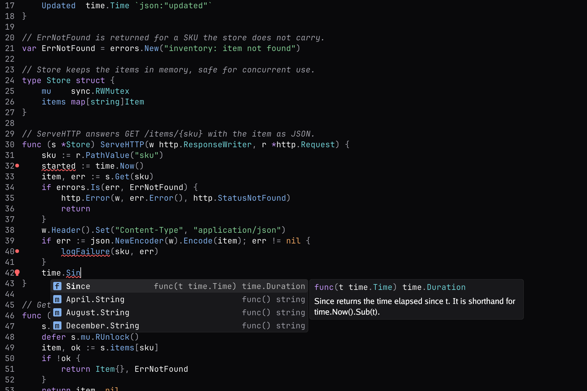
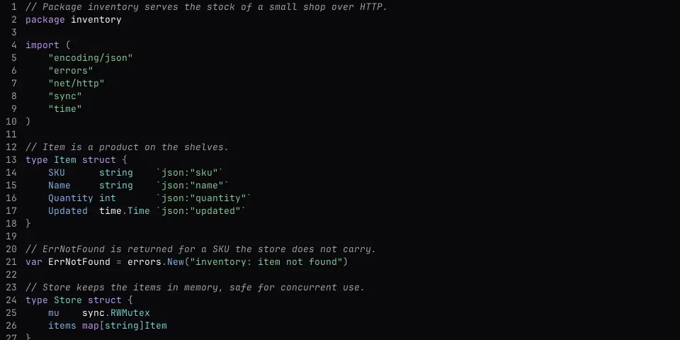
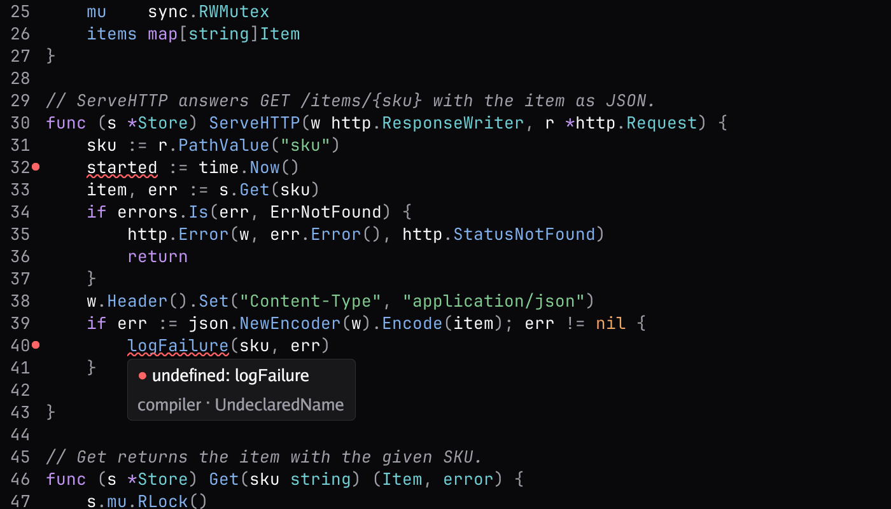
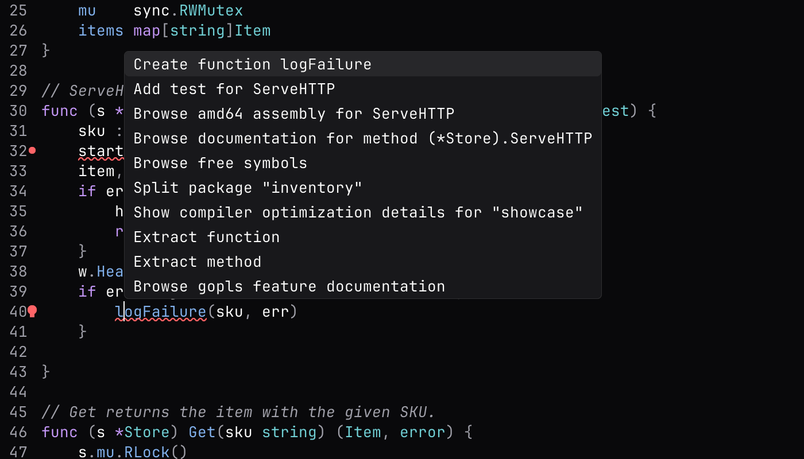
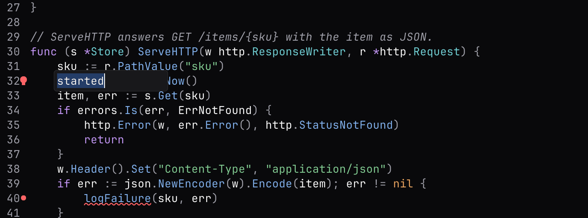
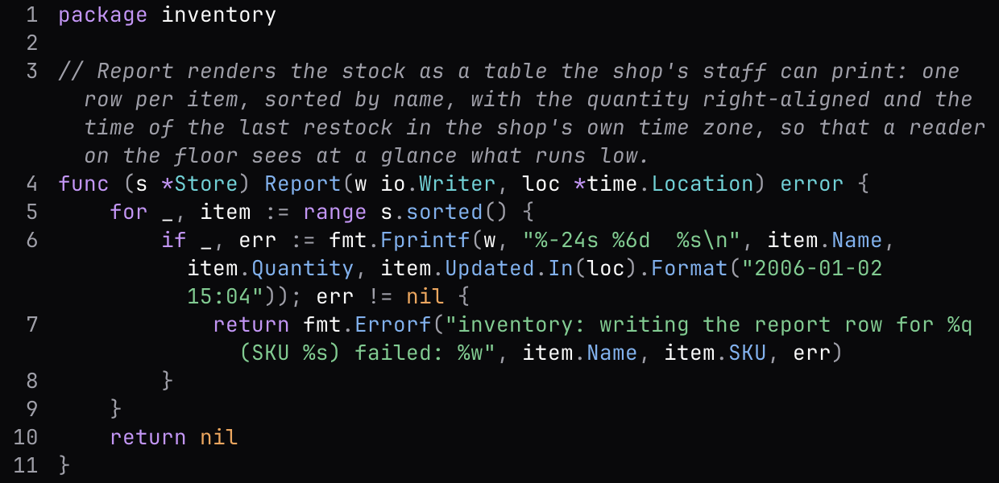
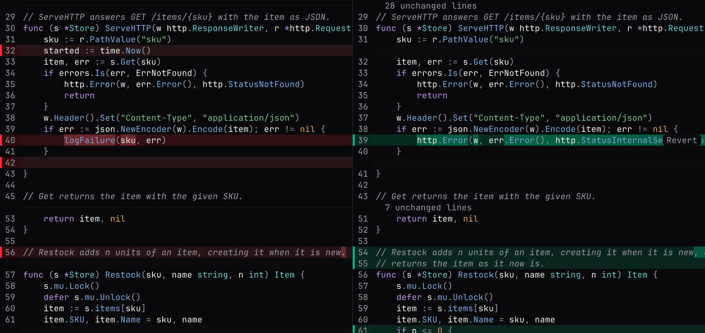
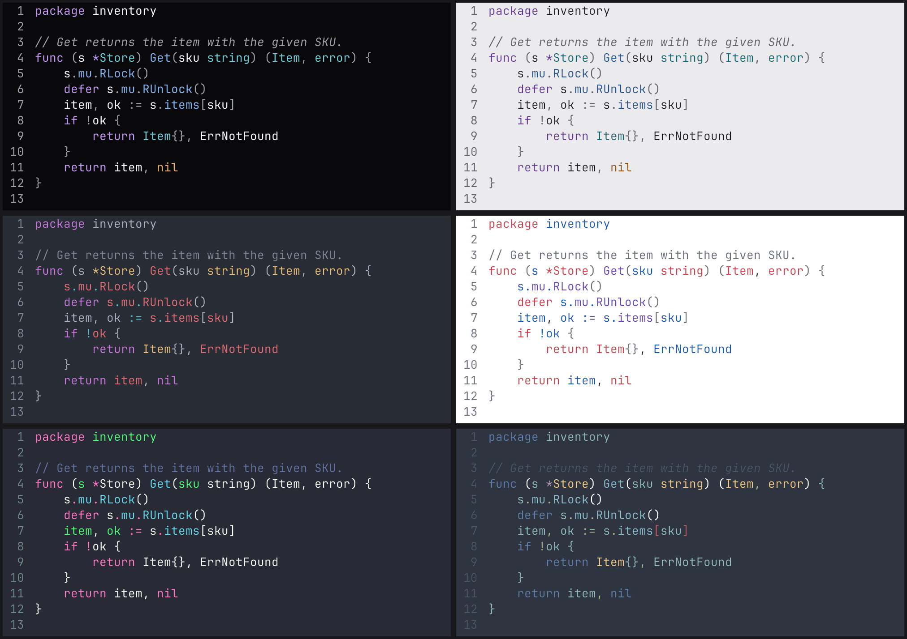

<div align="center">
  <h1>godemirror</h1>
  <p><strong>A code editor for <a href="https://gioui.org">Gio</a> apps, written in Go: syntax highlighting, completions from any language server, and side-by-side diffs, without embedding a browser.</strong></p>
  <p>
    <a href="https://pkg.go.dev/github.com/lichdotdev/godemirror"></a>
    <a href="https://github.com/lichdotdev/godemirror/actions/workflows/ci.yml"></a>
    
    
    
    <a href="LICENSE"></a>
  </p>
  <p><a href="https://lichdotdev.github.io/godemirror/"><strong>Try the Editor in your browser</strong></a>, compiled to WebAssembly.</p>
  
</div>

The usual ways to show code in a Go desktop app are a webview running
CodeMirror or Monaco, which means two UI stacks kept in step across a
JavaScript bridge, or a plain text widget that lacks highlighting, line
numbers and a language server. godemirror is a Gio widget instead. You lay out its `Editor`,
`View` or `DiffView` in your frame loop like any other widget, theme it with
your colors, and attach gopls or any LSP server in a few lines.

<p align="center">
  
</p>

## Why godemirror

- **One UI stack.** The editor is drawn by Gio in your process. Keystrokes,
  selection and scrolling stay in Go, so nothing crosses a JavaScript bridge.
  The library's packages are pure Go; the Gio app around them builds as any
  Gio app does, with cgo on Linux.
- **CodeMirror's editing model, checked against CodeMirror.** The document,
  transactions, undo history and commands are ported from CodeMirror 6 and
  tested against goldens the real packages write, so cursor motion and undo
  behave the way users of web editors expect.
- **Language servers in a few lines.** `lsp.Attach` connects an `Editor` to
  a server that speaks LSP 3.17 (tested with gopls) for diagnostics, completion,
  hover, signature help, go to definition, references, rename, code actions
  and formatting. `lsp/servers` lists 428 servers, with install recipes for
  252, so your app can pick the right one for a file.
- **Cheap to draw at full screen.** Each visible row is one cached image, so a screen
  of code costs a handful of quads, and highlighting runs off the UI
  goroutine: a 13,000-line file shows at once and takes its colors when they
  are ready. CSS, Go, HTML, Java, JavaScript, TypeScript, Python and Rust are
  parsed by Lezer grammars ported to Go and tagged as CodeMirror tags them.
- **Diffs you can act on.** `DiffView` shows two versions unified or side by
  side, collapses unchanged runs, tints the words that changed within a line,
  and puts a Revert on the chunk under the pointer.

### Who it is for

Go developers building desktop tools on Gio that show or edit code: git
clients, code review, log viewers, notebooks, IDE-like apps. If your app
already runs in a browser, CodeMirror itself is the better fit. godemirror is
tested on Linux; macOS and Windows build but CI does not run them yet.

## Features

### Editor

`Editor` is the opt-in editable view, with the document model of CodeMirror 6
ported to Go: transactions, change sets you can map positions through,
multiple cursors (Ctrl+D, Ctrl+Alt+Up/Down, and Alt+drag for a rectangle with
`RectangularSelection`), undo
history that groups changes as CodeMirror does, input methods, snippets with
fields Tab visits, and decorations and widgets that follow edits. Its hooks
(`Complete`, `Hover`, `SignatureHelp`, `Definition`, `References`, `Rename`,
`CodeActions`) take any source; `lsp` fills them from a language server.



### Language servers

`lsp` is a Language Server Protocol 3.17 client: `lsp.Start` runs a server,
`lsp.Attach` binds it to an `Editor`, and from then on edits go to the server
and its answers show in the editor. Diagnostics are underlined with a dot in
the gutter, F8 walks them, and hover renders the server's Markdown with its
code highlighted. Ctrl+. or the bulb lists the code actions on a line, F2
renames in place, F12 and Ctrl+click go to a definition, and Shift+F12
highlights the references. `Document.Format` and `Document.Symbols` format the
document and list its outline. `lsp/servers` knows which server a file wants
and how to install it: `servers.Lookup("main.go")` returns gopls first.

<p>
  
  
</p>

### Code view

`View` shows a document read-only, with a line gutter, selection and copy,
search, decorations on lines, any Gio widget on a line or between lines, and
`Split` shows two side by side, row for row. Lines wrap the way CSS `pre-wrap`
does, each continuation row hanging under its line's indentation, or scroll
sideways. A scroll the program makes glides there in 140 ms.



### Diff view

`DiffView` diffs two documents itself, or shows a file of a `git diff` patch,
unified or side by side: unchanged runs collapsed behind expanders, the words
that changed within a line tinted, a Revert on the chunk under the pointer, and
review threads anchored to file lines.



### Highlighting

A file's language is picked by its name. Lezer grammars, and the Kotlin and
shell modes of CodeMirror's legacy modes, tag code exactly as CodeMirror does;
other languages are read by [chroma](https://github.com/alecthomas/chroma) and
given the same tags. `StyleTags` make a grammar's tags finer
(`RicherGoTags` and its siblings), and `Highlight` hands the highlighted runs
of any text to a caller that draws it.

### Themes

`DarkTheme` and `LightTheme`, CodeMirror themes ported spec for spec
(`OneDark`, `GitHubLight`, `GitHubDark`, `Dracula`, `Nord`), or a theme of your
own built from a `HighlightStyle`.



## Quick start

godemirror needs **Go 1.27** or later.

```bash
go get github.com/lichdotdev/godemirror
```

An `Editor` on a file, with the language server the catalog picks for it. This
is the heart of [`cmd/examples/lsp`](cmd/examples/lsp/main.go), which compiles
with the library; run it with `go run ./cmd/examples/lsp main.go`.

```go
editor, err := godemirror.NewEditor("monospace", unit.Sp(13))
if err != nil {
	return err
}
if err := editor.SetState(godemirror.EditorStateConfig{Filename: path, Doc: string(text)}); err != nil {
	return err
}

srv := servers.Lookup(path)[0] // gopls for a .go file
client, err := lsp.Start(ctx, lsp.Config{Command: srv.Command, RootDir: root, Settings: srv.Settings})
if err != nil {
	return err
}
defer client.Close()
doc, err := lsp.Attach(client, editor, lsp.FileURI(path), lsp.Options{
	LanguageID: servers.LanguageID(servers.FileType(path)),
	Invalidate: window.Invalidate, // diagnostics arrive between frames
})
if err != nil {
	return err
}
defer doc.Close()

// in the frame loop, for each app.FrameEvent
if _, err := editor.Layout(gtx); err != nil {
	return err
}
```

A read-only view:

```go
view, err := godemirror.New("monospace", unit.Sp(13))
if err != nil {
	return err
}
view.SetContent(godemirror.Content{Filename: "main.go", Text: source})
// in the frame loop: view.Layout(gtx)
```

A diff, side by side, with a revert:

```go
diff, err := godemirror.NewDiffView("monospace", unit.Sp(13), godemirror.DiffOptions{
	Collapse: &godemirror.Collapse{Margin: 3, MinSize: 4},
	Revert:   func(c godemirror.Chunk) { /* put c.Lines back in the file */ },
})
if err != nil {
	return err
}
diff.Split = true
diff.SetDocs("main.go", original, modified)
// in the frame loop: diff.Layout(gtx)
```

An `Editor` counts positions in UTF-8 bytes of `EditorState.Doc`; the read-only
views count a `Pos` column in runes.

## Compared with CodeMirror

godemirror started as a port of CodeMirror 6 and keeps what it ported checked
against the real packages; what CodeMirror lacks, it builds.

| CodeMirror 6 | godemirror |
|---|---|
| `EditorView`, `EditorState`, `view.dispatch`, `updateListener` | `Editor`, `EditorState`, `Dispatch`, `OnUpdate` |
| `ChangeSet`, `EditorSelection`, `history()` | `ChangeSet`, `EditorSelection`, built into `Editor` |
| `@codemirror/autocomplete`, `@codemirror/lint`, `hoverTooltip` | `Complete`, `SetDiagnostics`, `Hover` |
| `@codemirror/lsp-client` | package `lsp`, with rename, code actions and formatting |
| `EditorView` read-only, `lineWrapping` | `View`, `View.Wrap` |
| `MergeView`, `unifiedMergeView` | `DiffView` |
| `HighlightStyle.define`, `@lezer/highlight` | `NewHighlightStyle`, package `tags` |

**Limits.** What godemirror does not do, and the traps a caller should know,
are in [`docs/ceilings.md`](docs/ceilings.md).

## The demo

`cmd/godemirror-demo` shows what the library draws, in a window or headless:

```bash
go run ./cmd/godemirror-demo -edit -file main.go -lsp gopls   # an Editor with gopls
go run ./cmd/godemirror-demo -old a.go -file b.go -split       # a diff of two files
go run ./cmd/godemirror-demo -file view.go -wrap -theme nord   # a wrapped View
```

Headless, `-shot out.png` writes the last frame, `-scale 2` draws it sharp,
and `-record script -frames dir` runs a script of keys, typing and clicks and
writes every frame; `go run ./cmd/godemirror-demo -h` lists the rest.

The [site](https://lichdotdev.github.io/godemirror/) runs `cmd/wasmdemo`, the
Editor and the DiffView built for the browser. `site/build.sh` builds it into
`_site`; serve that directory (`python3 -m http.server -d _site`) to try it.

## Requirements

Linux is the platform godemirror is built and tested on. macOS and Windows
build, and find fonts by scanning their font directories, but CI does not run
there yet.

- **Go 1.27**. The library is pure Go and builds with `CGO_ENABLED=0`; the demo
  opens a window through Gio's `app` package, which needs a C toolchain on
  Linux.
- **Gio's system libraries** for your platform (on Linux: Wayland or X11,
  `libxkbcommon`, EGL and Vulkan headers), as listed in
  [Gio's install guide](https://gioui.org/doc/install).
- **fontconfig** (`fc-match`, `fc-list`), where it is installed, to resolve font
  families and fall back for missing characters. Without it (stock Windows and
  macOS, a bare Linux), `New` reads the fonts in the platform's font directories
  instead and matches the family by the name each font carries, failing with
  `ErrFontNotFound` when none has it; `NewFromFonts` takes the font files'
  contents and draws a character they lack as a box.

## Build from source

```bash
go build ./...
go test ./...
```

[CONTRIBUTING.md](CONTRIBUTING.md) has the gate a change goes through, how to
run the demo headless, and how to report a bug or propose a change.

## License

[MIT](LICENSE) © 2026 omartelo

`internal/lezer` ports [Lezer](https://lezer.codemirror.net) and its CSS, Go,
HTML, Java, JavaScript, Python and Rust grammars, MIT licensed © 2018 Marijn Haverbeke and others: see
[its license](internal/lezer/LICENSE). `internal/stream` ports
`@codemirror/language`'s stream parser and the Kotlin and shell modes of
[`@codemirror/legacy-modes`](https://github.com/codemirror/legacy-modes), MIT
licensed © 2018-2021 Marijn Haverbeke and others: see
[its license](internal/stream/LICENSE). The editor (`Editor`, `EditorState`, `ChangeSet`,
`EditorSelection`) ports [`@codemirror/state`](https://codemirror.net/docs/ref/#state),
`@codemirror/view`, `@codemirror/commands`, `@codemirror/language` and
`@marijn/find-cluster-break`, MIT licensed © 2018-2024 Marijn Haverbeke and
others: see [their license](LICENSE.codemirror).

`lsp/servers` holds data converted from
[nvim-lspconfig](https://github.com/neovim/nvim-lspconfig) and
[mason-registry](https://github.com/mason-org/mason-registry), Apache-2.0: see
[its license](lsp/servers/LICENSE.apache) and [notice](lsp/servers/NOTICE); its filetype
tables come from Vim by way of Neovim, under [the Vim license](lsp/servers/LICENSE.vim).
