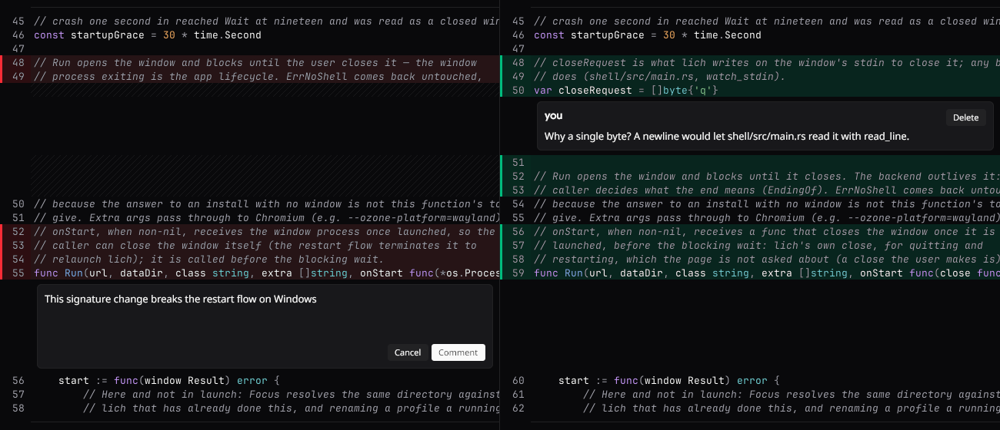

<div align="center">
  <h1>godemirror</h1>
  <p><strong>A read-only code view for Gio, built to stand in for CodeMirror.</strong></p>
  <p>
    Syntax-highlighted code with a line gutter, wrapping or sideways scrolling,
    selection and copy, line decorations, widgets on and between lines, and a
    side-by-side split that stays level. Drawn as one image per visible row, so
    a full screen of code costs a handful of quads.
  </p>
  <p>
    
    
    
    <a href="LICENSE"></a>
  </p>
  
</div>

## Why godemirror

[lich](https://github.com/omartelo/lich) is moving from a web window to a native
[Gio](https://gioui.org) app, and the one thing it used CodeMirror for is showing
code: the diff of a checkout, unified or side by side, and the preview of a file.
None of that edits text. godemirror is that viewer, and nothing lich-specific is
in it, so any Gio app can show code with it.

godemirror lets you:

- **Show code that reads like code.** Monospace rows highlighted by
  [chroma](https://github.com/alecthomas/chroma) from the file name, sorted
  into CodeMirror's classHighlighter classes and colored by `DarkTheme`,
  `LightTheme` or a theme of your own. Highlighting runs off the UI
  goroutine: a 13,000-line file shows at once and takes its colors when they are
  ready.
- **Wrap, or don't.** Lines break after spaces the way CSS `pre-wrap` does, or
  scroll sideways with Shift and the wheel.
- **Decorate lines.** Tint a line and its gutter cell, put a strip down the
  gutter, rule a separator, hatch a filler row, and replace the line numbers
  with labels of your own: everything a diff needs.
- **Put widgets on lines.** Any Gio widget after a line's text or against the
  right edge (an *Expand 44 unchanged lines* button, a *Revert*), optionally
  shown only while the pointer is over the line's block.
- **Open space between lines.** A `BlockWidget` lays out any Gio widget under a
  line: a review thread, a comment box with an Editor. Its state is yours, so
  rebuilding the content around it never loses what was being typed.
- **Split side by side.** Two documents row for row, scrolling down together and
  sideways each on its own. Unlike two CodeMirror editors, the split can wrap: a
  pair of lines takes the taller side's rows, and a block on one side leaves the
  same room on the other.
- **Show a diff.** `DiffView` diffs two documents itself or shows a file of a
  `git diff` patch: unified with old and new line numbers, or side by side,
  unchanged runs collapsed behind an expander, a Revert on each chunk, and
  review threads anchored to file lines. Its colors are part of the theme.
- **Select and copy.** Drag, double click for a word, triple click for a line,
  Shift+click to extend, Ctrl+A and Ctrl+C. Copying gives back the text as it
  was, tabs included, and `SelectedLines` turns the selection into the line span
  an action works on.

## Getting started

```bash
go get github.com/lichdotdev/godemirror
```

```go
view, err := godemirror.New("JetBrainsMono Nerd Font", unit.Sp(13))
if err != nil {
	return err
}
view.SetContent(godemirror.Content{Filename: "main.go", Text: source})

// in your frame loop
if _, err := view.Layout(gtx); err != nil {
	return err
}
```

`Content` also carries `Labels`, `Decorations`, `Widgets` and `Blocks`, indexed
by document line. `SetContent` shows a new document from its top;
`UpdateContent` swaps in a new version of the same one (a diff with lines pulled
in) without moving the scroll. For two sides, build a `godemirror.Split` and
give `Left` and `Right` their own content.

The deliberate limits, and what they mean for a caller, are in
[`docs/ceilings.md`](docs/ceilings.md).

## The demo

`cmd/godemirror-demo` lays a git diff out the way lich does: expandable gaps,
Revert on hover, review threads and the side-by-side split.

```bash
git diff > /tmp/change.patch
go run ./cmd/godemirror-demo -diff /tmp/change.patch -new path/to/changed/file -split
```

In the window: **Alt+W** toggles wrapping, **Alt+S** switches between unified
and side by side, and **Alt+N** opens a comment under the selected lines.
`-file` shows a single file instead, and `-bench N` with `-shot out.png` runs it
headless and reports frame times.

## Requirements

- **Go 1.27**. No C toolchain: everything here is pure Go.
- **Gio's system libraries** for your platform (on Linux: Wayland or X11,
  `libxkbcommon`, EGL and Vulkan headers), as listed in
  [Gio's install guide](https://gioui.org/doc/install).
- **fontconfig** (`fc-match`, `fc-list`) to resolve font families and fall back
  for missing characters. This is what keeps godemirror Linux-first today.
  Without it, `New` fails with `ErrNoFontconfig`; `NewFromFonts` takes the font
  files' contents instead and draws a character they lack as a box.

## Build from source

```bash
go build ./...
go test ./...
```

## License

[MIT](LICENSE) © 2026 omartelo
