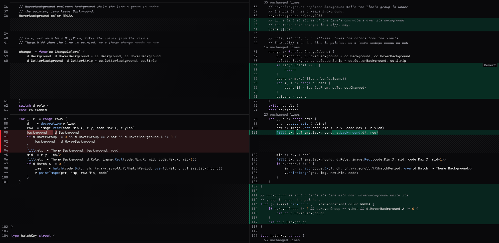

<div align="center">
  <h1>godemirror</h1>
  <p><strong>CodeMirror's read-only experience, native to Go.</strong></p>
  <p>
    A code view and a diff view for <a href="https://gioui.org">Gio</a>:
    syntax-highlighted code with a line gutter, wrapping or sideways scrolling,
    selection and copy, line decorations, widgets on and between lines, and
    diffs unified or side by side. Drawn as one image per visible row, so a full
    screen of code costs a handful of quads.
  </p>
  <p>
    <a href="https://pkg.go.dev/github.com/lichdotdev/godemirror"></a>
    <a href="https://github.com/lichdotdev/godemirror/actions/workflows/ci.yml"></a>
    
    
    
    <a href="LICENSE"></a>
  </p>
  
</div>

## Why godemirror

On the web, an app that shows code reaches for
[CodeMirror](https://codemirror.net): highlighting, decorations, widgets
between lines, a merge view. A native Go app has had nothing like it, and
drawing code with a GUI toolkit's text stack is slow at full screen.
godemirror brings that experience to Go, for viewing: file previews, diffs,
code review, logs. It does not edit text.

godemirror lets you:

- **Show code that reads like code.** Monospace rows highlighted by
  [chroma](https://github.com/alecthomas/chroma) from the file name, sorted
  into CodeMirror's classHighlighter classes and colored by `DarkTheme`,
  `LightTheme` or a theme of your own. Highlighting runs off the UI
  goroutine: a 13,000-line file shows at once and takes its colors when they are
  ready.
- **Wrap, or don't.** Lines break after spaces the way CSS `pre-wrap` does, or
  scroll sideways with Shift and the wheel.
- **Decorate lines.** Tint a line and its gutter cell, put a strip down the
  gutter, rule a separator, hatch a filler row, and replace the line numbers
  with labels of your own: everything a diff needs.
- **Put widgets on lines.** Any Gio widget after a line's text or against the
  right edge (an *Expand 44 unchanged lines* button, a *Revert*), optionally
  shown only while the pointer is over the line's hover group.
- **Open space between lines.** A `BlockWidget` lays out any Gio widget under a
  line: a review thread, a comment box with an Editor. Its state is yours, so
  rebuilding the content around it never loses what was being typed.
- **Split side by side.** Two documents row for row, scrolling down together and
  sideways each on its own. Unlike two CodeMirror editors, the split can wrap: a
  pair of lines takes the taller side's rows, and a block on one side leaves the
  same room on the other.
- **Show a diff.** `DiffView` diffs two documents itself or shows a file of a
  `git diff` patch: unified with old and new line numbers, or side by side,
  unchanged runs collapsed behind an expander, a Revert on each chunk, and
  review threads anchored to file lines. Its colors are part of the theme.
- **Select and copy.** Drag, double click for a word, triple click for a line,
  Shift+click to extend, Ctrl+A and Ctrl+C. Copying gives back the text as it
  was, tabs included, and `SelectedLines` turns the selection into the line span
  an action works on.

## Getting started

godemirror needs **Go 1.27** or later.

```bash
go get github.com/lichdotdev/godemirror
```

```go
view, err := godemirror.New("JetBrainsMono Nerd Font", unit.Sp(13))
if err != nil {
	return err
}
view.SetContent(godemirror.Content{Filename: "main.go", Text: source})

// in your frame loop
if _, err := view.Layout(gtx); err != nil {
	return err
}
```

`Content` also carries `Labels`, `Decorations`, `Widgets` and `Blocks`, indexed
by document line. `SetContent` shows a new document from its top;
`UpdateContent` swaps in a new version of the same one (a diff with lines pulled
in) without moving the scroll. For two sides, build a `godemirror.Split` and
give `Left` and `Right` their own content.

The deliberate limits, and what they mean for a caller, are in
[`docs/ceilings.md`](docs/ceilings.md).

## Coming from CodeMirror

| CodeMirror 6 | godemirror |
|---|---|
| `EditorView` with `EditorState.readOnly` | `View` |
| `EditorView.lineWrapping` | `View.Wrap` |
| `EditorView.theme`, `classHighlighter` | `Theme`, `TokenClass` |
| `lineNumbers({formatNumber})` | `Content.Labels` |
| `Decoration.line`, `gutterLineClass` | `LineDecoration` |
| `Decoration.mark` | `LineDecoration.Spans` |
| `Decoration.widget` | `LineWidget` (on a line), `BlockWidget` (between lines) |
| `state.selection`, `dispatch({selection})` | `Selection`, `Select`, `SelectLines` |
| `EditorView.scrollIntoView` | `ScrollToLine` |
| `state.doc.lines`, `doc.line(n)` | `LineCount`, `LineText` |
| `MergeView`, `unifiedMergeView` | `DiffView` (`Split` on or off) |
| `collapseUnchanged` | `DiffOptions.Collapse`, or the gaps of a patch |
| `mergeControls` | `DiffOptions.Revert`, `Chunks` |
| `highlightChanges` | `DiffOptions.HighlightChanges` |

## The diff view

`DiffView` shows the difference between two versions of a file, the way
CodeMirror's merge view does: unified, with the old and the new line number
side by side in the gutter, or side by side, with each deletion paired with
the addition that replaced it.

```go
diff, err := godemirror.NewDiffView("JetBrainsMono Nerd Font", unit.Sp(13), godemirror.DiffOptions{
	Collapse:         &godemirror.Collapse{Margin: 3, MinSize: 4},
	HighlightChanges: true,
	Revert:           func(c godemirror.Chunk) { /* put c.Lines back in the file */ },
})
if err != nil {
	return err
}
diff.SetDocs("main.go", original, modified)

// in your frame loop
if _, err := diff.Layout(gtx); err != nil {
	return err
}
```

`SetDocs` diffs two documents itself. To show what git already diffed, read the
patch with `ParsePatch` and pass a file to `SetPatch`; the unchanged lines git
left out are asked for through `DiffOptions.Expand` and laid in with `FillGap`,
in as many parts as your backend answers in. `Chunks`, `SelectedRange` and
`SelectedChanges` read the diff in file line numbers, and `SetBlocks` anchors
a review thread to a line of either file. The colors live in `Theme.Diff`, in
both `DarkTheme` and `LightTheme`.

## The demo

`cmd/godemirror-demo` shows what the library draws, in a window or headless: a
file in a `View`, or a diff in a `DiffView`, with expandable gaps, Revert on
hover and comments anchored to lines as `DiffBlock`s.

```bash
go run ./cmd/godemirror-demo -file view.go                   # a file
go run ./cmd/godemirror-demo -old a.go -file b.go -changes   # a diff of two files
git diff > /tmp/change.patch
go run ./cmd/godemirror-demo -diff /tmp/change.patch -new path/to/changed/file -split
```

In the window: **Alt+W** toggles wrapping, **Alt+S** switches a diff between
unified and side by side, and **Alt+N** opens a comment under the selected
lines. Reverting a chunk of two files puts it back and shows the diff again.
`-light` uses `LightTheme`, and `-bench N` with `-shot out.png` runs it headless
and reports frame times.

## Requirements

- **Go 1.27**. The library is pure Go and builds with `CGO_ENABLED=0`; the demo
  opens a window through Gio's `app` package, which needs a C toolchain on
  Linux.
- **Gio's system libraries** for your platform (on Linux: Wayland or X11,
  `libxkbcommon`, EGL and Vulkan headers), as listed in
  [Gio's install guide](https://gioui.org/doc/install).
- **fontconfig** (`fc-match`, `fc-list`) to resolve font families and fall back
  for missing characters. This is what keeps godemirror Linux-first today.
  Without it, `New` fails with `ErrNoFontconfig`; `NewFromFonts` takes the font
  files' contents instead and draws a character they lack as a box.

## Build from source

```bash
go build ./...
go test ./...
```

[CONTRIBUTING.md](CONTRIBUTING.md) has the gate a change goes through, how to
run the demo headless, and how to report a bug or propose a change.

## License

[MIT](LICENSE) © 2026 omartelo
